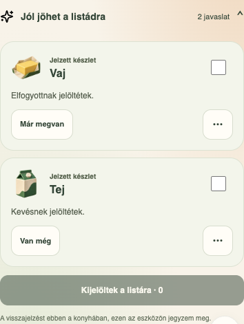
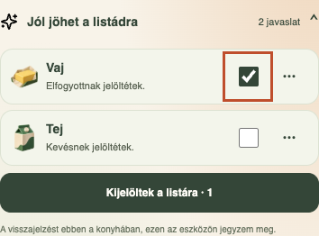
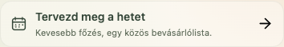
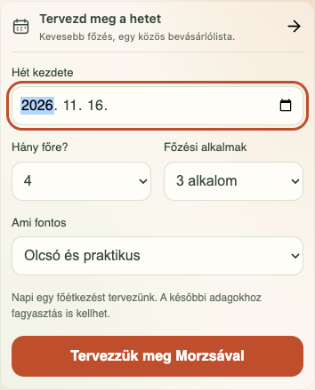
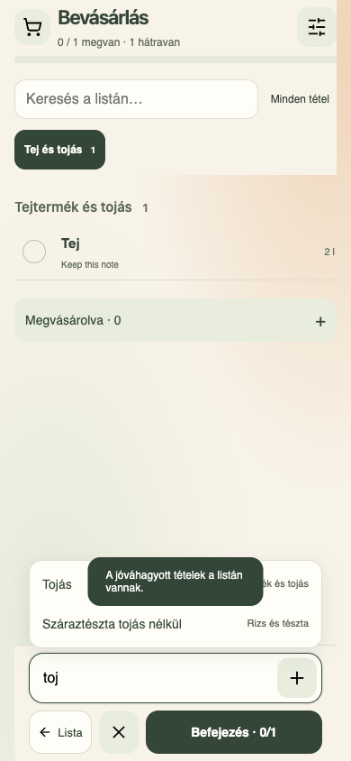

# Tömörebb javaslatok, heti tervező és bolti autocomplete

A „Jól jöhet a listádra” és az Áttekintés termékjavaslatai egy sorba kerültek: kisebb kép, terméknév, indok és legalább 44 px-es műveletek. A ritkább „Van még / Már megvan”, elhalasztás és elutasítás a hárompontos menüből érhető el. Ellenőrzendő készletnél a „Van még” továbbra is közvetlen művelet. A listajavaslatok kijelölése továbbra is csak előnézet; a jóváhagyás ment.

A „Morzsa figyel” cím helyett az Áttekintés és a chat „Érdemes ránézni” feliratot használ. A becsült vásárlási ritmus továbbra is becslésként, magyarázattal jelenik meg.

A heti tervező kis, lenyitható kártya. Az űrlapon több hely marad a mezők és a fókuszjelzés között; mobilon a dátum és a hosszabb prioritásválasztó teljes szélességű. A mezők 16 px-es szövege elkerüli az iOS automatikus nagyítását, a piszkozat lenyitás után is megmarad.

A „Boltban vagyok” hozzáadása a meglévő katalógusból és saját termékekből ajánl. Érintés, fel/le nyíl, Enter és Escape is használható. A találatok a mező felett jelennek meg, a mentési visszajelzés felettük kap helyet. A kiválasztás a meglévő vásárlási mentést és őrzött visszavonást használja; megőrzi egy már listán szereplő tétel mennyiségét és megjegyzését. A szabad szöveg és több termék együttes felvétele is megmarad.

## Ellenőrzés

- A szintetikus 390 px-es próbában a két egyszerű termékjavaslat magassága egyenként 159,2 px-ről 62 px-re csökkent.
- A tests/check-compact-surfaces.mjs 67 böngészős ellenőrzése sikeres: 320/360/390/1280 px, magyar és angol feliratok, űrlapgeometria, elérhető mentés, megőrzött piszkozat, kijelölés és jóváhagyás, billentyűzetes autocomplete, ismételt felvétel, mennyiség/megjegyzés megőrzése, Undo, több termék, szabad szöveg és axe-vizsgálat.
- A fixture teljesen helyi, szintetikus adatokat használ, minden külső hálózati kérést tilt. A képeken a helyi képfixture látható.
- Az új ellenőrzés a védett webes kiadási folyamat része. A meglévő teljes release gate és a natív regressziók megmaradnak.

[Ellenőrzési eredmények](compact-surfaces-2026-11-17/results.json)

| Korábbi listajavaslatok | Tömör listajavaslatok |
|---|---|
|  |  |

