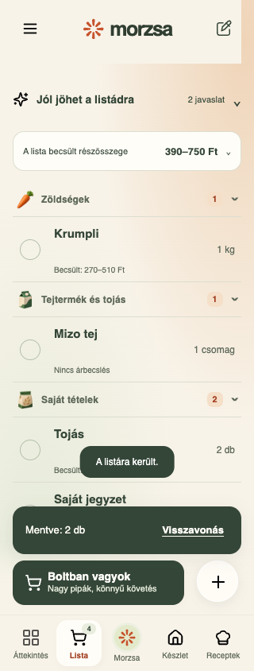
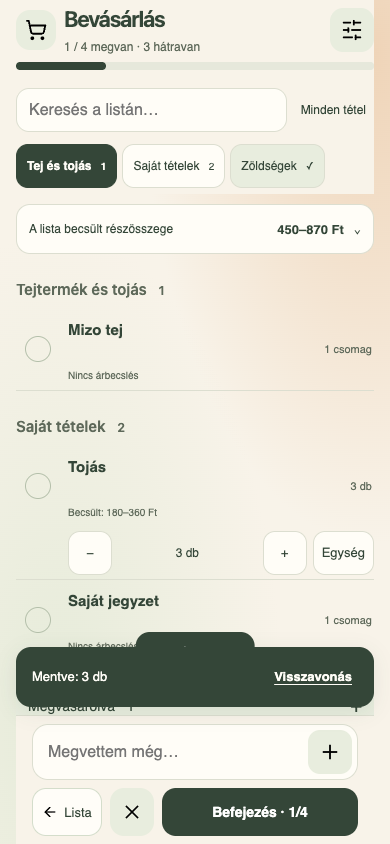
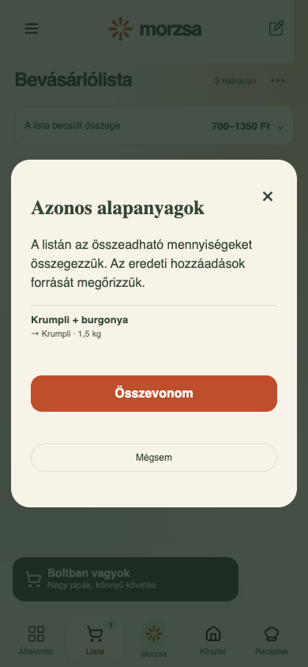

# Készlet és bevásárlólista — kiadás előtti javítások

## Látható változások

- **Egységes alapanyagnevek:** például a „burgonya”, „potato” és „potatoes” ugyanazt a Krumpli-tételt használja. A kézi, bolti, beszélgetéses és receptből történő hozzáadás is megőrzi a már meglévő sor mennyiségét, megjegyzését és receptkapcsolatait. A korábbi alias-kulcsot nem nevezzük át automatikusan. A laktózmentes, növényi, fagyasztott és egyéb külön termékek külön maradnak.
- **Régi duplikátumok áttekintése:** a listában és a készletben megjelenik a „Megnézem az összevonást” lehetőség. A megerősítés előtt látszanak az összevonandó nevek és az eredmény. A készlet a legerősebb meglévő elérhetőséget tartja meg; a listán összeadható g/kg és ml/l mennyiségeket átváltjuk. Eltérő megjegyzés, receptkapcsolat, vásárlási állapot vagy nem összeadható egység esetén a sorok külön maradnak. Az eredeti hozzáadási forrást és hozzáadót az additív `ingredientAliases` mező megőrzi. Mentés után őrzött visszavonás érhető el.
- **Gyors mennyiségmódosítás:** a mennyiségre bökve közvetlen „− / +” gombok nyílnak. Grammnál 50 g, milliliternél 100 ml, más egységnél 1 a lépés. Az „Egység” vagy a terméknév a részletes szerkesztőt nyitja meg. A listán és a „Boltban vagyok” nézetben is használható; mentés után a billentyűfókusz megmarad, a visszajelzés nem takarja el a gombokat.
- **Automatikus kategóriák:** az ismert nevek és szinonimák katalóguskategóriát kapnak. Az olyan új név, mint a „Mizo tej” vagy „Barilla penne”, óvatos szóalapú kategóriajavaslatot kap. A név ettől nem változik. A tételnél kézzel választott kategória elsőbbséget élvez; az ismeretlen emlékeztetők saját tételként maradnak.
- **Becsült árak:** a támogatott termékek alatt forintos ársáv látszik, a lista fölött pedig összeg vagy részösszeg. A kibontott összesítő jelzi a lefedettséget, a kimaradó tételeket és a még megvásárolandó, ismert árú tételek becslését. A 65 alapár a KSH 2025-ös országos átlagára, ±30% Morzsa-ráhagyással; a csomag- és darabtömeg-feltételezések láthatók. Ezek nem élő bolti árak.

## Közös adatok és kompatibilitás

A korábbi `morzsa-v1` és `morzsa-v2` mentések, az egyedi mezők, a készlet, a receptkapcsolatok és a közös háztartás meglévő adatai megmaradnak. Háztartáshoz csatlakozáskor nincs automatikus import vagy összevonás. Az explicit készletimport is felismeri a meglévő szinonimákat.

Az összevonás a meglévő `apply_household_changes` RPC egyetlen tranzakciója. Előtte friss adatot olvasunk, minden érintett rekord előnézeti revízióját és értékét ellenőrizzük. A közben megváltozott tétel az egész összevonást elutasítja; a többi adatot nem írjuk felül. Függő bevásárlólistás mentés mellett nem indul összevonás. A visszavonás ugyanezeket az ellenőrzéseket használja. Sikertelen eszköz-cache írás nem változtatja sikertelenné a szerver által már elfogadott mentést.

Új adatbázis-migráció vagy éles felhasználói adatmódosítás nem szükséges.

## Ellenőrzés és bizonyíték

- Teljes validáció: 378 Node-teszt, a meglévő SQL-regressziók és 9 Python-teszt átment. A kiadási kapu 32 axe-szkennel, 54 korábbi célzott regresszióval, natív vezérlő/fókusz- és recepttesztekkel, valamint az új 42 bevásárlólistás ellenőrzéssel sikeres. A külön mobilregresszió Chromium alatt 134, WebKit alatt 132 ellenőrzést teljesített, túlcsordulás és böngészőhiba nélkül. A kompakt felületek, teljesítmény és Plus-latencia regressziói, a webes bundle ellenőrzése és a natív felületszinkron is sikeres.
- A célzott böngészős ellenőrzés 42 tesztet teljesít: HU/EN, 320/390/1280 px, bolti mennyiség és fókusz, régi mentés, összevonás és visszavonás, két konyhatag, revízióváltozás azonos végértékkel, tranzakciós ütközés, kapcsolat- és cache-hiba, függő mentés. A képernyők axe WCAG A/AA ellenőrzése hibamentes.
- A célzott modellek 13 regressziós tesztje lefedi a névazonosítást, importot, mennyiségeket, metaadatokat, jsonb objektumkulcs-sorrendet és az árbecslési konverziókat.
- Az új böngészős ellenőrzés a kötelező `design-audit/check-release.mjs` részévé vált. A meglévő publikálási kapu és a tesztelt artifactból történő Pages-deploy megmaradt.
- A tesztek elkülönített SQL-adatbázist és szintetikus fiókokat használnak; nincs éles adat, fizetett AI-hívás vagy külső hálózati írás. Valódi készülékes VoiceOver és bolti használat külön ellenőrzést igényel.

[Árbecslési források és kiszerelések](SHOPPING-PRICE-BASELINES-2026-11-18.md) · [42 teszt eredménye](evidence/pantry-shopping-release-2026-11-18/results.json)

